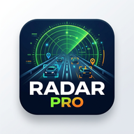

# RotaPro — Sürücü Asistanı

Tek sayfalık, **bağımlılığı yalnızca Leaflet olan** mobil sürücü asistanı (PWA). Hız ve hız limiti takibi, sesli navigasyon, radar/tehlike uyarıları, yakıt maliyeti ve Spotify / YouTube Music entegrasyonu.



## Özellikler

- **Hız göstergesi** — hız limitine göre renk değiştirir, limit aşımında sesli ve sesli olmayan uyarı verir. Cihaz hız bilgisi vermezse konum farkından hesaplanır.
- **Navigasyon** — OSRM ile rota, Türkçe sesli yol tarifi, rotadan çıkınca otomatik yeniden hesaplama. Harita sürüş yönüne göre dönebilir (Kuzey Yukarı seçeneği de var).
- **Radar ve trafik ışıkları** — OpenStreetMap verisinden; yaklaşırken yön filtreli uyarı.
- **Kendi bildirimlerin** — çukur, yol çalışması, kaza, kapalı yol, tek yön. Bildirimler süresi dolunca otomatik silinir (kaza 4 sa, kapalı yol 12 sa, yol çalışması 7 gün, çukur ve tek yön 30 gün). Yalnızca senin cihazında saklanır, diğer sürücülerle paylaşılmaz.
- **Hava durumu** — Open-Meteo ile sıcaklık ve rüzgar.
- **Yakıt analizi** — benzin / dizel / LPG / elektrik için tahmini tüketim ve maliyet.
- **Sürüş kaydı** — iz ve sürüş özeti (mesafe, süre, ortalama hız, maliyet).
- **Müzik** — Spotify (uzaktan kumanda) veya YouTube Music (uygulamayı açar).
- **Sesli komut** — "eve git", "hastane", "müzik aç" vb. (tarayıcıya bağlı).
- **HUD modu**, park yeri kaydı, ETA paylaşımı, açık/koyu tema.
- **PWA** — ana ekrana eklenir, uygulama kabuğu ve gezilen harita karoları çevrimdışı önbelleğe alınır.

## Kurulum

```bash
git clone https://github.com/cihantrkn46/rotapro.git
cd rotapro
python3 -m http.server 8000
```

Tarayıcıda aç: `http://localhost:8000`

> GPS, Service Worker ve Spotify girişi için **HTTPS gerekir** (localhost hariç).

Gerekli dosyalar: `index.html`, `style.css`, `app.js`, `sw.js`, `manifest.json`, `icon-192.png`, `icon-512.png`, `icon-maskable-512.png`, `apple-touch-icon.png`.

## Yayına alma

GitHub Pages, Cloudflare Pages, Vercel veya Netlify yeterlidir (hepsi ücretsiz HTTPS verir). GitHub Pages için: Repo → Settings → Pages → `main` / `root`.

Yeni sürümü yükledikten sonra eski sürümü görürsen uygulamayı kapatıp iki kez aç (servis worker'ı önce önbellekteki sürümü verir).

## Spotify kumandası (isteğe bağlı)

Spotify'ı uygulamadan kumanda etmek için:

1. [developer.spotify.com/dashboard](https://developer.spotify.com/dashboard) üzerinden bir uygulama oluştur.
2. **Redirect URI** olarak uygulamanın tam adresini ekle (ayarlarda "Spotify'a Bağlan"a basınca gösterilir).
3. Ayarlar → Müzik → **Spotify'a Bağlan** ve Client ID'ni gir.

Notlar: Spotify, geliştirici modundaki uygulamalar için sahibinin Premium olmasını ve sınırlı sayıda yetkili kullanıcıyı şart koşar (Şubat 2026 kuralları). Telefonda Spotify uygulamasının yakın zamanda açılmış olması gerekir. **YouTube Music** için resmi kumanda API'si yoktur; uygulama onu yalnızca açar.

## Teknoloji

- **Harita:** [Leaflet 1.9.4](https://leafletjs.com/) + [OpenStreetMap](https://www.openstreetmap.org/) karoları
- **Yol verisi:** OpenStreetMap + [Overpass API](https://overpass-api.de/) (yedek sunucu: kumi.systems)
- **Rota:** [OSRM](http://project-osrm.org/) (demo sunucu)
- **Adres arama:** [Nominatim](https://nominatim.openstreetmap.org/)
- **Hava:** [Open-Meteo](https://open-meteo.com/)
- API anahtarı gerekmez (yalnızca isteğe bağlı Spotify kumandası için Client ID).

## Gizlilik

- Ayarlar, bildirimler, hedef geçmişi ve (bağlarsan) Spotify token'ı **cihazda** (`localStorage`) tutulur; RotaPro'nun kendi sunucusu yoktur.
- Uygulama çalışırken konumun **üçüncü taraf servislere gönderilir**: Overpass (hız limiti, radar), Nominatim (adres), OSRM (rota), Open-Meteo (hava). Bu servislerin kendi gizlilik politikaları geçerlidir.
- Konum paylaşımı yalnızca sen "Paylaş" düğmesine bastığında, cihazının paylaşım menüsüyle yapılır.

## Bilinen sınırlar

- Gerçek zamanlı trafik yoğunluğu ve diğer sürücülerin kaza bildirimleri yoktur; "trafik" göstergesi yalnızca kendi hızından tahmin edilir.
- OSM'de hız limiti etiketi olmayan yollarda limit, yol sınıfına göre **tahmin edilir** ve yanlış olabilir.
- OSRM demo sunucusu ve OpenStreetMap karo sunucusu yoğun/ticari kullanım için uygun değildir; geniş kitleye açmadan önce kendi veya ücretli bir servise geçmek gerekir.
- iOS'ta yüklü PWA içinde sesli komut çalışmayabilir.

## Yasal uyarı

Bu uygulama **yardımcı bilgi** sağlar. Yasal hız limitleri, trafik kuralları ve yol güvenliği **sürücünün sorumluluğundadır**. Sürüş sırasında ekranla etkileşime girme. Uygulama bir ceza, kaza veya hasardan sorumlu tutulamaz.

## Lisans

MIT — bkz. [LICENSE](LICENSE). Harita verisi © OpenStreetMap katkıda bulunanları (ODbL).

## Geliştirici

**MCT YAZILIM**
